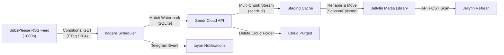

<div align="center">

# 🌊 nagare (流れ)

> **Autonomous anime RSS scheduler that delivers through Seedr, organizes for Jellyfin, and purges the cloud.**

[](https://github.com/Praveensenpai/nagare/releases)
[](https://www.rust-lang.org/)
[](https://github.com/Praveensenpai/nagare)
[](LICENSE)

[⚡ Quickstart](#-quickstart) • [✨ Key Features](#-key-features) • [🖥️ Interactive TUI](#%EF%B8%8F-interactive-tui) • [🔄 Architecture](#-architecture--pipeline) • [⚙️ Configuration](#%EF%B8%8F-configuration) • [⏰ Automation](#-systemd-automation)

</div>

---

## 💡 Overview

**nagare (流れ)** monitors your weekly anime release feeds (defaulting to SubsPlease 1080p), queues new episodes into your Seedr.cc cloud account without overflowing quota, downloads them over high-speed parallel streams, renames and places files directly into your Jellyfin library, triggers a Jellyfin library refresh, sends Telegram notifications, and automatically purges cloud storage.

It comes equipped with both a **headless CLI** for scheduled execution and a **Ratatui terminal dashboard (TUI)** for interactive monitoring and tracking.

```text
┌────────────────────────────────────────────────────────────────────────┐
│ 流れ nagare            [1] Tracked  [2] Live Feed  [3] Activity        │
├────────────────────────────────────────────────────────────────────────┤
│ ID  Anime Title                  Watermark    Match Pattern   Status   │
│ 1   Frieren: Beyond Journey's End S02E05      Frieren S2      ● Active │
│ 2   Dungeon Meshi                 S01E24      Dungeon Meshi   ● Active │
│ 3   Chainsaw Man                  S01E12      Chainsaw Man    ● Active │
├────────────────────────────────────────────────────────────────────────┤
│ Cloud: 1.4 / 5.0 GiB [████░░░░░░░░]        Library: ~/Videos/Anime     │
│ [Tab] View  [r] Run Scan  [a] Add Show  [d] Untrack  [/] Search  [?]   │
└────────────────────────────────────────────────────────────────────────┘
```

---

## ✨ Key Features

- ⚡ **Zero-Cloud-Bloat Caching**: Checks free Seedr quota before queueing, waits for cloud caching, downloads, and immediately deletes cloud folders upon completion.
- 📺 **Jellyfin-Native Organization**: Automatically standardizes filenames and folder hierarchies into `Show Name/Season 01/Show Name - S01E05 - 1080p.mkv` format.
- 🖥️ **Interactive Terminal Dashboard**: Real-time TUI built with `ratatui` and `crossterm` to browse the live feed, search releases, manage watermarks, and inspect cloud storage.
- 📡 **Conditional RSS Fetching**: Uses HTTP `ETag` and `Last-Modified` conditional headers to return `304 Not Modified` when the feed hasn't changed.
- 📱 **Telegram & Mobile Alerts**: Integrated with `tayori` to dispatch rich notifications upon episode grab and critical failure alerts.
- 🛡️ **Reliable State Tracking**: Local SQLite database keeps an audit log, season/episode watermarks, and tracked infohashes to avoid duplicate grabs.

---

## ⚡ Quickstart

### 1. Build and Install

```bash
cargo install --path .
```

### 2. Connect Seedr Account

```bash
# Authenticate your Seedr account via seedr-dl
seedr-dl auth
```

### 3. Track Your First Anime

```bash
# Track interactively from the live feed
nagare add

# Or track directly by name
nagare add "Frieren"
```

### 4. Launch the Dashboard

```bash
# Open interactive TUI
nagare
```

---

## 🖥️ Interactive TUI

Launch `nagare` without arguments or run `nagare tui` to access the interactive dashboard:

| Keybinding | Action |
| :--- | :--- |
| `Tab` / `Shift-Tab` | Cycle between tabs (**Tracked Shows**, **Live Feed**, **Activity & Cloud**) |
| `1` / `2` / `3` | Jump directly to a tab |
| `j` / `k` (or arrows) | Navigate up and down through list entries |
| `r` | Trigger manual scheduler scan and pipeline grab |
| `a` | Open modal dialog to add a new tracked anime |
| `d` | Remove / untrack highlighted show |
| `t` | Track highlighted show directly from the Live Feed |
| `/` | Live filter / search feed releases |
| `?` | Toggle keybindings cheat sheet modal |
| `q` / `Esc` | Close dialog or exit TUI |

---

## 🔄 Architecture & Pipeline



---

## ⚙️ Configuration

Configuration is loaded from `~/.config/nagare/config.toml`:

```toml
# Jellyfin Anime library destination
library_dir = "~/Videos/Anime"

# SubsPlease 1080p release feed URL
feed_url = "https://subsplease.org/rss/?r=1080"

# Temporary download staging directory
staging_dir = "~/.cache/nagare/incoming"

# Minimum free Seedr storage headroom (bytes)
min_free_bytes = 2147483648

# Maximum duration to wait for Seedr cloud caching (seconds)
max_wait_secs = 1800

# Number of parallel download threads per episode
download_threads = 4

# Send Telegram notifications via tayori
notify = true

[jellyfin]
url = "http://127.0.0.1:8096"
api_key = "your-jellyfin-api-key"
```

---

## ⏰ Automation

Set up a systemd user timer to run `nagare run` automatically every hour:

### `~/.config/systemd/user/nagare.service`
```ini
[Unit]
Description=nagare anime RSS scheduler

[Service]
Type=oneshot
ExecStart=%h/.cargo/bin/nagare run
StandardOutput=journal
StandardError=journal
```

### `~/.config/systemd/user/nagare.timer`
```ini
[Unit]
Description=Run nagare hourly

[Timer]
OnCalendar=hourly
Persistent=true

[Install]
WantedBy=timers.target
```

Enable and start the timer:
```bash
systemctl --user daemon-reload
systemctl --user enable --now nagare.timer
```

---

## 📜 License

Licensed under the [MIT License](LICENSE).
